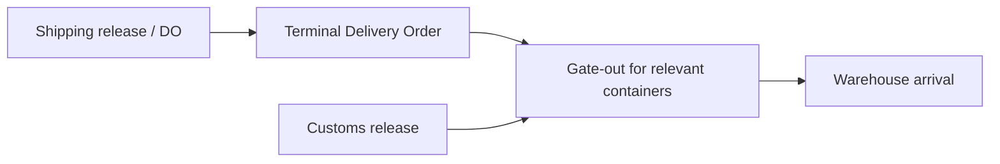
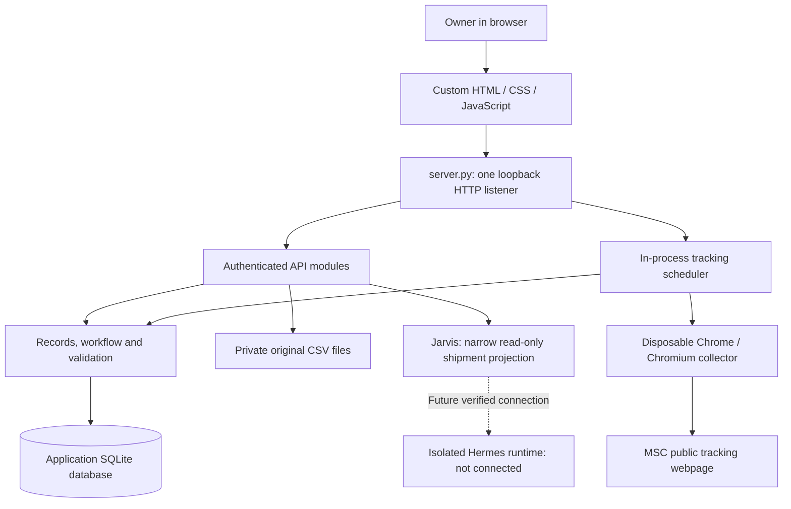

# Libra Mission Control — a mental model

**Reviewed against the current source: 2 November 2026.**

This guide explains the product, the machinery behind it and how to recover it. The client explanation comes first; the technical and recovery sections are for the person operating the system. It describes the local pilot, not a promise that every planned integration is live.

Jump to [architecture](#8-the-architecture), [failure modes](#12-how-it-can-fail), [starting the app](#13-how-to-get-the-local-application-back-up), [backup and restore](#14-backup-and-restore), or the [client demonstration](#17-a-five-minute-client-demonstration).

## 1. What this project does

**Libra Mission Control gives the Import Officer one place to see each shipment, its clearing progress, who owns the next action and what still needs confirmation.**

It brings information from client reports and operational updates into a shared shipment register. It follows the job from expected arrival through clearing, delivery and administrative closure.

For a client, the value is being able to answer:

- Where does this shipment stand?
- What has been recorded, and where did that information come from?
- What needs to happen next, and who is responsible?
- What is blocking delivery or closure?

### A client explanation you can reuse

> Libra Mission Control is our clearing coordination workspace. It brings shipment milestones, document information, delivery progress and outstanding actions into one view. Each job keeps its own history, so we can explain both its current position and the evidence behind it. The system highlights what needs attention while the Import Officer remains accountable for coordinating the job.

When demonstrating today's pilot, add:

> We currently use historical reports and human-entered updates. Carrier tracking has an initial MSC connector, but reliable unattended retrieval is still being validated. Staff permissions, client access, Odoo and the full Hermes AI connection are later phases.

## 2. The picture to keep in your head

Think of the system as four connected parts:

| Part | Its job |
|---|---|
| **A digital job file** | Keep the client, BL, milestones, assignments, invoices, movement events and closure information together. |
| **A rules engine** | Calculate the stage, check dependencies and identify follow-ups from recorded facts. |
| **A coordination desk** | Show responsible teams, next actions, reported blockers and requests awaiting a response. |
| **An evidence trail** | Preserve original imports, subsequent reports, owner changes and tracking observations. |

The dashboard is the window into these parts. The backend applies the rules. The database remembers the work.

The most useful distinction is **recorded fact versus calculated interpretation**. A report can supply a warehouse date; that date alone cannot supply the number of containers delivered. A rule can identify an information gap; that gap is not proof that a document was never issued.

## 3. What exists today, and what is still planned

| Area | Current position |
|---|---|
| Departments and clients | Multiple clients, department assignment, renaming, hiding and restoring are implemented. |
| Report imports | Reviewed GZI and CHI CSV mappings; flexible optional columns, previews and reviewed report updates. Other clients support manual jobs while their mappings await review. |
| Operational register | Manual jobs, milestones, invoice status, assignments, movements, follow-ups and closure checks are implemented. |
| Overview and QAC | Real scoped counts, next actions and rule-based record findings. QAC findings do not independently certify documents or compliance. |
| Access | One authenticated owner. Team names and department filters are organisation features, not staff permissions or client isolation. |
| MSC tracking | Scheduler, collector, evidence, differences and guarded updates are implemented. Live unattended retrieval remains unreliable; a recorded live validation encountered Access Denied. |
| Jarvis | Read-only local guided chat about shipments and pending actions. It opens empty and responds when asked. Hermes AI remains disconnected. |
| Voice | Optional on-device browser dictation and local read-aloud, where supported. No remote speech fallback. |
| Notifications and Telegram updates | Outbound delivery and Telegram shipment actions are not active. Existing Hermes Telegram services remain separate. |
| Odoo, regulatory automation and staff/client roles | Deferred. Regulatory issues and explicit holds can be recorded manually. |

All current imports are historical test data. Implemented code, passing tests and a working live external connection are three different things.

## 4. What a job means

A job belongs to an explicit client and has a stable internal ID such as `LMC-00001`. Its BL is a business reference used for lookup and reviewed report matching.

**The BL is not the database identity.** Two legitimate jobs can share a BL. The application keeps them separate unless a narrowly defined duplicate-repair review establishes that an unused extra row can be archived safely.

The relationship is:

```text
Department → Client → Shipment / job
                         ├─ Source reports and history
                         ├─ Milestones and invoice records
                         ├─ Import Officer and Field Agent
                         ├─ Movement events
                         ├─ Coordination items and holds
                         └─ Carrier observations, where available
```

The report's **File Handler means Field Agent**. The **Import Officer** is separately responsible for the whole job. Accounts, QAC and Regulatory own their respective work areas; assigning a team does not create a user account or send that team a message.

## 5. The five lifecycle stages

| Stage | How to understand it |
|---|---|
| **Awaiting arrival** | Actual arrival has not been established using the job's arrival basis. Passing the ETA does not establish arrival. |
| **In clearing** | Arrival is recorded and the job has not yet progressed into recorded delivery movements. |
| **In delivery** | Reconciled movement records show gate-out or warehouse deliveries, with delivery still incomplete. |
| **Delivered** | All containers are accounted for at the client's warehouse. Imported reports can instead display a clearly labelled historical Delivered proposal. |
| **Completed** | The owner explicitly confirms completion after delivery and all applicable closure requirements are satisfied. |

For operational jobs, the backend derives progress from milestones and reconciled quantities. Imported jobs retain their historical stage proposal until their quantities and movement history are reconciled. Editing a descriptive field does not silently verify an old report.

### Arrival has more than one meaning

- **ETA:** a forecast.
- **Berthing:** the vessel berths in Nigeria. GZI ATA/ATD and reviewed CHI SEA ATA retain this meaning.
- **Discharge:** the relevant containers are discharged at the Nigerian destination. This is the main arrival milestone for the new carrier-tracking flow.
- **Gate-out:** containers leave the terminal.
- **Warehouse arrival:** containers reach the client's destination.

The system preserves these separately. A transshipment discharge abroad is not Nigerian arrival. Carrier movement to a consignee is not independent proof of warehouse delivery. The existing more-than-five-days-without-TDO follow-up remains anchored to berthing.

### Delivery and completion are different

A delivered job can still need ECD, client invoicing, empty-container returns or an applicable shipping-line final invoice. Unknown applicability needs resolution; it does not become an exemption automatically. Refund settlement is not a universal completion requirement.

## 6. Clearing is a set of dependencies

The work does not move through one universal straight line. Some activities can overlap; others have firm prerequisites.



DO supports TDO. TDO and Customs release support gate-out for the relevant containers. There is no added rule that Customs release must precede TDO. Dates and release coverage must support the movement being entered.

Other important rules are:

- Pre-arrival follow-ups begin five calendar days before ETA for shipping invoice, rotation number, PAAR and OBL information.
- PAAR supports the assessment follow-up. Client approval is part of obtaining final assessment; a separate draft-received date is not required by the current UI.
- Final-assessment received date plus C Number clears draft-stage requests without inventing approval dates or approvers.
- Final assessment starts duty-receipt follow-up. A reported awaiting-duty-receipt status is retained even if assessment details still need completing.
- Terminal invoice collection normally follows duty receipt, although earlier receipt is allowed. Reported combined shipping/terminal coverage avoids duplicate collection requests.
- More than five days after berthing without a dated TDO means **confirm TDO status and the blocker**, not assume it was never issued.
- ECD means Exchange Control Documents. Follow-up starts seven days after warehouse delivery; unresolved split-delivery dates are flagged rather than assigned a guessed anchor.

A received document or a human-entered paid status is recorded evidence, not independent payment verification. Rating date means rated-through coverage, not payment date. Rating-expiry automation and detailed authority/AEO/examination rules are not inferred from report labels.

## 7. How information becomes the dashboard

### Importing a report

1. Select the client and upload its CSV.
2. Preserve the original bytes and identify the batch using the client and file hash.
3. Map recognised headings using that client's reviewed mapping. Preserve unknown columns and distinguish absent, blank and uninterpretable values.
4. Build a preview. Previewing does not add jobs to the register.
5. Review how rows match existing jobs. A unique client/BL match can update the existing job; ambiguity needs review.
6. Apply the reviewed import. Keep the original source and any earlier reports.
7. Combine usable source values with independent owner updates and movement events.
8. Calculate the visible stage, quantities, findings and next actions.

Re-uploading identical bytes for the same client reuses the batch. A changed report goes through reviewed update matching. Blank cells do not erase known values, missing rows do not delete jobs, and independent owner corrections remain protected.

### Updating a job

An update carries the job ID, its current revision, a reason and a unique command ID. The backend checks access and business rules before saving.

- **Revision:** prevents an old screen from silently overwriting newer work. A conflict requires refreshing and reviewing the latest record.
- **Command ID:** makes the same command safe to retry without applying it twice. Changing its content requires a new command ID.
- **Transaction:** commits the relevant changes together or rolls them back together.
- **Audit:** records who changed what and the before/after values.

For example, suppose a hypothetical job has ten containers, six recorded at gate-out and four recorded at the warehouse. Its warehouse balance is six, provided the starting total and movement history are reconciled. Six at gate-out does not mean six delivered.

## 8. The architecture

The application is a **modular monolith**: several subject-focused Python modules run inside one application process. There is no separate frontend build service, message broker or deployed AI service required for the local register.



| Location | Responsibility |
|---|---|
| `frontend/index.html`, `styles.css`, `app.js` | App shell, screens, forms and API requests. |
| `frontend/jarvis.js`, `jarvis.css` | Floating chat, scope changes and optional local voice controls. |
| `frontend/globe-scene.js`, `port-scene.js` | Decorative animations. The globe does not display live ship positions. |
| `server/server.py` | The only HTTP listener; serves an explicit asset list, checks requests and registers API routes. |
| `server/auth.py`, `client_scope.py` | Owner sessions and validated department/client selection. |
| `server/store.py` | SQLite connections, schema migrations and migration backups. |
| `server/imports.py`, `report_updates.py` | CSV interpretation, original evidence and reviewed report revisions. |
| `server/records.py`, `workflow.py` | Join source evidence with current work; derive stages, quantities and actions. |
| `server/operations.py`, `coordination.py`, `clients.py` | Validated changes, movements, assignments, holds and client organisation. |
| `server/shipments.py` | Shipment, overview and action-query routes. |
| `server/tracking.py`, `msc_browser.py`, `msc_tracking.py`, `browser_process.py` | Scheduling, collection, parsing, evidence, comparison and guarded carrier updates. |
| `server/jarvis.py` | Read-only briefings and bounded session-scoped conversation memory. |
| `server/jarvis_transport.py` | Prepared transport code only; it is not registered as a live provider. |
| `tests/` | Automated checks using temporary storage and loopback ports. |

The backend uses Python's standard library. The frontend is plain browser code with no package installation or bundling step. Carrier retrieval additionally needs an installed, sandbox-capable Chrome/Chromium. The frontend sends JSON to the same server that served the page.

## 9. What the screens are telling you

| Screen | Question it answers |
|---|---|
| Overview | What needs the Import Officer's attention across this selection? |
| Shipments | Which job should I open? |
| Import centre | What does this report say, and how will it affect existing jobs? |
| Import Officer desk | Who owns the next action, and what response or resolution is pending? |
| QAC review | Which records have inconsistencies or information gaps to review? |
| Job tabs | What is recorded for this individual job, including its sources and changes? |
| Jarvis | Can I get a concise explanation of the selected jobs and pending actions? |

Stage counts count jobs. Action counts count action items. Team queues overlap, so adding their counts does not produce a unique-job total. A review finding describes a record question, not an automatically established compliance breach.

## 10. What runs automatically

### Workflow calculations

Stages and next actions are calculated from stored information when records are read. The dashboard can show these without Hermes. Historical calculations retain the reporting cut-off; an unknown cut-off is not replaced with today's age.

### Carrier tracking

Starting `server/server.py` starts the tracking scheduler in that process. It is not an installed OS cron job. Merely constructing an application in a test does not start collection.

The worker discovers eligible operational MSC jobs, checks due work, records observations and changes, and persists the next due time. After success, the next slot is 08:00 or 16:00 Africa/Lagos. Failures back off; denials, challenges, changed pages and unavailable browsers use a longer delay. These are tracking-check times, not proof that outbound reminders are active.

Historical unreconciled imports, hidden clients and completed jobs are excluded. Accepted all-container empty-return evidence stops carrier monitoring; it does not mark the clearing job Completed.

The worker protects independent owner corrections. It does not infer release readiness, movement quantities or warehouse arrival. A later failed lookup retains earlier successful evidence.

**Current external limit:** the scheduler and guarded-update behaviour have automated validation, but live unattended MSC collection has encountered Access Denied. Do not promise reliable live tracking from the existence of the scheduler. Check the last successful retrieval and the latest error.

### Jarvis

Jarvis starts with an empty conversation. Only a submitted question or suggested prompt requests a reply. New chat and scope changes clear the conversation without requesting an automatic briefing.

Its current engine is deterministic local guidance. The backend exposes a selected shipment projection, not raw reports, financial columns, credentials or arbitrary files. Conversations are scoped to the owner session and selection, have bounded history and expire after inactivity. They are not saved as permanent transcripts.

Hermes runs separately. The existing default API has broader tools and context than Jarvis should receive. A verified isolated runtime and credential bootstrap are still required. Restarting Hermes will not make this connection exist.

## 11. Where the important information lives

| Location | What it contains | Recovery significance |
|---|---|---|
| Source repository | Python, frontend assets, tests and checked-in documentation. | Restores the program, not the operational records. |
| `data/libra-test.sqlite3` | Jobs, clients, reports, owner password hash, sessions, changes, movements, commands, audit and tracking records. | Primary application state. |
| SQLite `-wal` / `-shm` sidecars, when present | SQLite working files. The WAL may contain committed changes not yet in the main database file. | Never discard them or copy only the main file from a running service. |
| `data/originals/` | Accepted original CSV bytes. | Keep these with the matching database and import history. |
| `data/backups/` | Migration backups and local working-file backups. | Useful recovery evidence, but not a scheduled off-machine backup system. |
| `data/activity.log` | Short development/fleet activity entries. | Separate from the database's operational audit trail. |
| `imports/sources/` | Optional private source fixtures. | Not shipped with a Git checkout. |
| Process memory | Jarvis conversations and running workers. | A restart clears conversations; persisted tracking due times remain. |

Git deliberately excludes private reports, databases, backups, sessions and credentials. **A Git push does not back up the shipment database or original reports.** SQLite is not claimed to be encrypted at rest; filesystem access and backup handling matter.

Local source is in this workspace. The approved future remote project subtree is `/opt/data/workspace/libra-mission-control`. It is a specifically approved project location beneath the reported Hermes state root; application data must remain separate from Hermes profile files. A local file or approved path does not prove the dashboard is deployed there or that its storage is persistent.

## 12. How it can fail

| Symptom | Likely layer | What to check or do |
|---|---|---|
| Browser says connection refused | Application process stopped, wrong port or wrong machine. | Check the listener and start the correct local service using section 13. |
| Page loads but records fail | API, database or runtime error. | Read the server terminal error; check the selected data directory, storage space and permissions. |
| Address already in use | Another process owns the port. | Identify it first. Do not kill every Python process or start competing copies. |
| Unexpected empty workspace or first-owner setup | Wrong/new data directory or a missing database. | Stop and find the original data. Do not create a new owner as a repair step for a lost workspace. |
| Jobs appear to have disappeared | Client/department filter, hidden client or archived duplicate. | Check All clients, department selection and Manage clients before assuming data loss. |
| Same BL appears twice | Distinct jobs or ambiguous matching. | Compare internal IDs and report history. Use reviewed updates; do not merge independently worked jobs blindly. |
| A save is rejected with 409 | Stale revision, changed review plan or reused command ID. | Refresh the record and review the latest facts before submitting a fresh action. |
| A movement or completion is rejected | Counts, prerequisite evidence or an explicit hold is unresolved. | Read the validation message and correct the facts. A delivery exception cannot bypass quantity totals or completion checks. |
| A historical job seems stuck | Reconciliation or source information is still incomplete. | Inspect the source, reporting cut-off and movement history; do not invent quantities to advance a stage. |
| Sign-in returns or requests fail with 401 | Session expired or was revoked. | Sign in again. Existing sessions expire after eight hours. |
| Tracking has no eligible jobs | Historical, hidden, completed, unsupported-carrier or invalid-BL jobs. | Inspect eligibility. Do not reconcile a historical job solely to force a live lookup. |
| Tracking reports browser unavailable or Access Denied | Browser runtime, source availability or source-page changes. | Review the diagnostic and next retry. Preserve prior evidence; do not bypass source restrictions or disable the browser sandbox. |
| Tracking stops when the laptop sleeps | Scheduler shares the application process and machine availability. | Restore the application; due work is persisted. Reliable always-on operation needs a separately reviewed deployment. |
| Jarvis says Hermes pending, or mic is disabled | Expected integration/capability boundary. | Local text guidance remains available. AI isolation and browser voice support are separate checks. |
| SQLite is locked or storage is full | Competing writers, long transactions, permissions or disk pressure. | Preserve data, stop competing app instances safely and inspect the cause. Do not delete the database or its WAL to clear the error. |

The failure can also be informational: a well-running application can display incomplete, late or incorrect human/source reports. Audit history explains changes; it does not make an external fact true.

## 13. How to get the local application back up

These instructions operate the **local Mac pilot**. They do not install or restart anything on the Oracle VPS or inside Dokploy.

### A. Check the process and data first

```bash
cd "/Users/mac/Documents/Libra Circle"
lsof -nP -iTCP:8800 -sTCP:LISTEN
ls -l data/libra-test.sqlite3
```

No listener normally means there is no service on that port. If a process is listed, identify its command before stopping it; `ps -p ACTUAL_PID -o pid=,command=` can help after replacing `ACTUAL_PID` with the observed number.

If the expected database is absent, stop and locate the real data directory or backup. The application can create a fresh workspace when pointed at an empty directory, which is not recovery of the previous one.

### B. Start the normal local workspace

Once the correct data is confirmed and the port is available:

```bash
cd "/Users/mac/Documents/Libra Circle"
python3 server/server.py
```

Leave that terminal running. Open **http://127.0.0.1:8800/**. The program binds to loopback only and defaults to this project's `data/` directory. Closing the process also stops its scheduler.

If using a different existing data directory or port, supply the exact approved values with `--data-dir` and `--port`. A different data directory means a different workspace. On another machine, `127.0.0.1` means that other machine; it does not point back to this Mac or the VPS.

### C. Check the application, then its data

In a second terminal:

```bash
curl --fail --show-error --max-time 5 http://127.0.0.1:8800/api/session
```

A JSON response confirms the API and its session-storage reads are responding. An unauthenticated result is normal before sign-in. It does not prove that MSC or Hermes is connected.

Sign in and check the expected departments, clients, representative job IDs, source history and latest movements. Review Carrier watch separately. A green local connection indicator does not prove every external integration is healthy.

To stop this foreground instance gracefully, use **Ctrl+C in its own terminal**. Do not use a blanket process-kill command. If a command is denied or requires unavailable privileges, stop and report the exact failure rather than attempting privilege workarounds.

## 14. Backup and restore

### Backup: keep code and data separately

For this pilot, a straightforward full-data backup is an **offline copy**:

1. Stop the application gracefully, including any other instance using the same data directory. Confirm there are no writers.
2. Copy the entire selected data directory to a dated private folder outside the project.
3. Keep the corresponding source commit/version with the backup record.
4. Keep an additional protected copy off the machine if recovery from disk loss is required.

After stopping all writers, this example backs up the default local data directory. It refuses to copy an empty/missing workspace and does not overwrite an existing backup:

```bash
cd "/Users/mac/Documents/Libra Circle"
python3 - <<'PY'
from datetime import datetime
from pathlib import Path
from zoneinfo import ZoneInfo
import os
import shutil

os.umask(0o077)
project = Path.cwd()
source = project / 'data'
if not (source / 'libra-test.sqlite3').is_file():
    raise SystemExit('Expected database not found. Locate the correct data first.')
folder = project.parent / 'Libra Mission Control Backups'
folder.mkdir(mode=0o700, exist_ok=True)
destination = folder / datetime.now(ZoneInfo('Africa/Lagos')).strftime('data-%Y%m%d-%H%M%S-%f')
shutil.copytree(source, destination)
print('Backup created:', destination)
PY
```

Do not copy just `libra-test.sqlite3` while the server is running. A live database snapshot should use SQLite's backup API, and a coordinated backup must still retain matching originals and other private application files. The automatic pre-migration snapshots are not a replacement for this full-data backup.

### Restore: preserve the failed workspace

1. Stop all application writers and verify the intended data directory.
2. Select a known-good full-data backup, including its original CSV files. Check its date and associated code version.
3. Validate the backup database before replacing anything. SQLite `PRAGMA integrity_check` should return `ok`; this checks database structure, not whether the business facts are correct.
4. Copy the backup into a separate staging folder. Keep the existing data folder intact until that copy is validated.
5. Rename the current data folder to a dated `data-before-restore-...` folder. Keep any WAL/SHM files with it.
6. Rename the staged folder to the exact data directory the service uses. Do not mix a restored database with sidecars from the failed one.
7. Start the matching application version and run the checks in section 13. Newer code may migrate an older database; do not assume older code can safely open a newer schema.

If there is no known-good backup, preserve the damaged directory and get help with diagnosis/recovery. Deleting it or reimporting a report cannot reconstruct independent owner changes, movement corrections, owner access, audit history or source links.

Owner authentication is part of the restored database. Restoring it can also restore older sessions; backups are private security material. There is no implemented self-service forgotten-password recovery flow. Handle password recovery and session invalidation as explicit administrative work, not by deleting state.

## 15. What survives a restart

| Item | After a normal restart using the same data directory |
|---|---|
| Jobs, reports, original files, updates and audit history | Retained. |
| Clients, department assignment and visibility | Retained. |
| Owner password hash and unexpired database sessions | Retained, subject to normal expiry/cookie availability. |
| Tracking due times and previous evidence | Retained; the scheduler resumes from persistent state and recovers stale claims. |
| Jarvis conversations | Cleared; they are process-local. |
| Browser filters/current screen | Some UI state resets; sidebar preference is separately stored in the browser. |
| A failed external connection | A restart does not guarantee it becomes available. |

A restart reloads the program; a restore replaces its stored state. A Git rollback changes source code; it does not roll back the database.

## 16. How to explain the engineering choices

| Choice | Benefit | Practical limit |
|---|---|---|
| One Python application and SQLite | Simple local operation, few runtime dependencies and one consistent validation path. | Process/machine availability affects both UI and scheduler; multi-user production scale needs measurement and deployment work. |
| Immutable source plus independent updates | Explain where a value came from without rewriting the original report. | Ambiguous source data needs review rather than automatic guesses. |
| Deterministic rules before AI | The same milestone, count and closure checks govern every implemented update path. | AI cannot supply missing physical evidence or approve work outside those rules. |
| Narrow read-only Jarvis boundary | Brief users without granting access to the whole machine or agent fleet. | Current local guidance is limited; the isolated Hermes runtime remains unfinished. |
| Replaceable carrier connector | Other shipping lines or an official API can feed the same observation model later. | Each source needs its own event mapping, access and live reliability validation. |
| Loopback owner-only pilot | Keeps development access deliberately narrow. | It is not yet a secure shared deployment, staff RBAC system or client portal. |

## 17. A five-minute client demonstration

1. Select a department and client. Explain that the view is scoped to their work, while the pilot still has one owner account.
2. Open Overview. Point out real stage counts, next actions and attention items. Explain that the globe is illustrative.
3. Open a sample job. Show the Import Officer, Field Agent, milestones and separate release/delivery facts.
4. Show a pending action and its responsible team. Explain the difference between awaiting a response and actually receiving a document.
5. Show Source & history. Demonstrate how an original report and a later update remain distinguishable.
6. Ask Jarvis for pending actions. Label the current response as local guided help, with Hermes AI still pending.

Use authorised or synthetic demonstration data. Describe live integrations only at their actually validated level. Reliable carrier retrieval, staff/client access, notifications, Odoo and detailed regulatory automation are the next capabilities to validate, rather than features to imply are already connected.

## 18. Where to look next

- [README](../README.md): running and using the current pilot.
- [API guide](api.md): routes, request shapes and validation behaviour.
- [Server entry point](../server/server.py): startup, network boundary and module registration.
- [Workflow rules](../server/workflow.py): calculated stages, follow-ups and closure requirements.
- [Tracking validation](msc_tracking_validation.md): recorded synthetic checks and the live-source limit; its dated results are not a continuous health monitor.
- [Tests](../tests/): executable examples of supported behaviour.

For a code change, the baseline checks are:

```bash
python3 -m unittest discover -s tests -v
node --check frontend/app.js
node --check frontend/jarvis.js
node --check frontend/globe-scene.js
node --check frontend/port-scene.js
```

Tests use isolated temporary storage. Private-fixture checks can skip when their source is absent. Passing these checks establishes the behaviour they exercise; it does not certify live MSC availability, a deployed Hermes runtime or production readiness.
